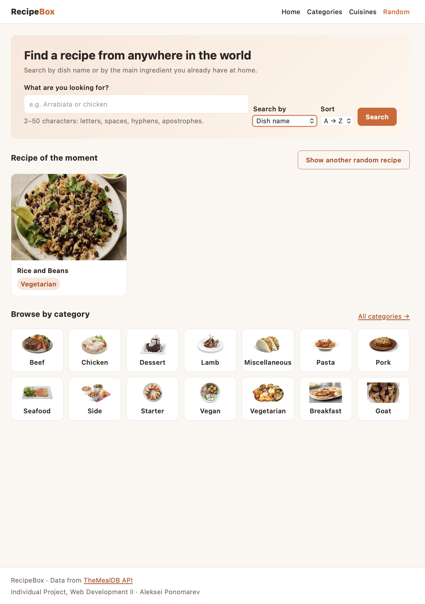
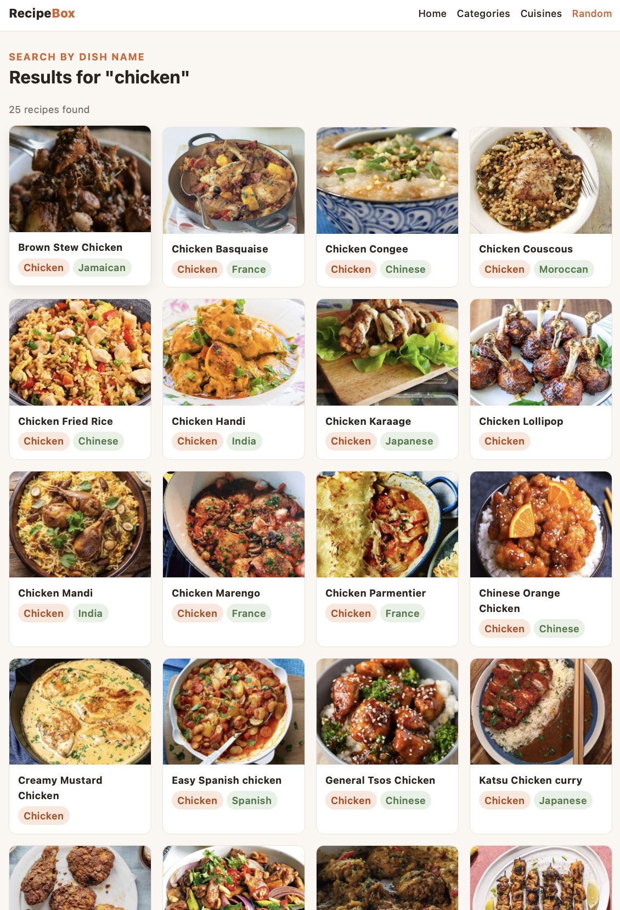
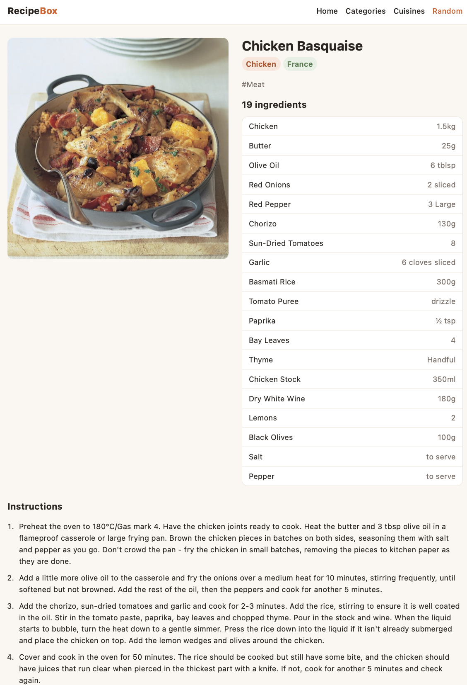

# RecipeBox – World Recipes Finder

Individual Project, VR 113153 Web Development II
Author: Aleksei Ponomarev

RecipeBox is a server-side web application built with **Express**, **Axios** and **EJS** (MVC structure).
The user searches for recipes by dish name or by main ingredient, browses meals by category and by
country cuisine, and opens a detailed recipe page with ingredients, step-by-step instructions and a video.

## API used

**TheMealDB API** – https://www.themealdb.com/api.php
The free test key `1` is used for development and education (stored in `.env`).

Endpoints used:

| Endpoint | Purpose |
|---|---|
| `GET /search.php?s=` | search meals by name |
| `GET /filter.php?i=` | meals with a main ingredient |
| `GET /filter.php?c=` | meals in a category |
| `GET /filter.php?a=` | meals of a cuisine (area) |
| `GET /lookup.php?i=` | full details of one meal |
| `GET /categories.php` | all categories with images and descriptions |
| `GET /list.php?a=list` | all cuisines |
| `GET /random.php` | one random meal |

## Features

- Search by dish name or by main ingredient (POST form with server-side validation)
- Sorting of results A→Z / Z→A
- Browse all categories and all cuisines
- Recipe page: ingredients built from the API's 20 numbered fields, numbered steps, tags, embedded YouTube video
- Random recipe
- "No recipes found" state, image placeholders, friendly error pages
- Responsive design for desktop and mobile

## Data processing

- Joining `strIngredient1–20` and `strMeasure1–20` into one ingredient list, skipping empty values, counting ingredients
- Splitting the instructions text into numbered steps
- Converting a YouTube watch link into an embed link
- Turning the comma-separated `strTags` into a list
- Sorting results alphabetically, sorting cuisines and removing "Unknown"
- Shortening long category descriptions
- Placeholders for missing images and data

## Routes

| Method | Route | Description |
|---|---|---|
| GET | `/` | home page: search form, random recipe, categories |
| POST | `/search` | validates the form and shows search results |
| GET | `/categories` | all categories |
| GET | `/category/:name` | meals in a category (`?sort=asc|desc`) |
| GET | `/cuisines` | all cuisines |
| GET | `/cuisine/:area` | meals of a cuisine (`?sort=asc|desc`) |
| GET | `/meal/:id` | recipe details |
| GET | `/random` | redirects to a random recipe |
| any | other URLs | custom 404 page |

## Middleware and error handling

- `express.static` – serves `/public` (CSS, images)
- `express.urlencoded` – reads the search form data
- `middleware/logger.js` – custom request logger (method, URL, status, time)
- `middleware/validateSearch.js` – custom validation of the search input (required, 2–50 characters, letters / spaces / hyphens / apostrophes, valid search type)
- `middleware/errorHandler.js` – 404 handler and centralized error handler `(err, req, res, next)`
- `services/mealService.js` – Axios with async/await, try/catch and a timeout. Network errors, timeouts,
  invalid API key (401/403), rate limit (429), other 4xx/5xx and empty results are handled: technical details
  are logged to the console and the user sees a friendly message. The server does not crash.

## Project structure

```
recipebox/
├── app.js                  # entry point: middleware, routes, error handlers
├── routes/mealRoutes.js    # route definitions
├── controllers/mealController.js  # request handling logic
├── services/mealService.js # Axios calls to TheMealDB
├── middleware/             # logger, validateSearch, errorHandler
├── utils/mealHelpers.js    # data processing
├── views/                  # EJS pages + partials (header, footer, mealCard)
├── public/                 # css, images
├── .env.example
└── package.json
```

## Installation and run

1. Install Node.js (version 18 or newer).
2. Install dependencies:
   ```
   npm install
   ```
3. Create the `.env` file from the example:
   ```
   cp .env.example .env
   ```
   (on Windows: `copy .env.example .env`). The default values work without changes.
4. Start the server:
   ```
   npm start
   ```
5. Open http://localhost:3000

## Screenshots





## Credits

- Data and images: [TheMealDB](https://www.themealdb.com/)
- Documentation used: Express, Axios, EJS and dotenv official docs
- AI assistance is described in the AI Declaration submitted in Canvas.
